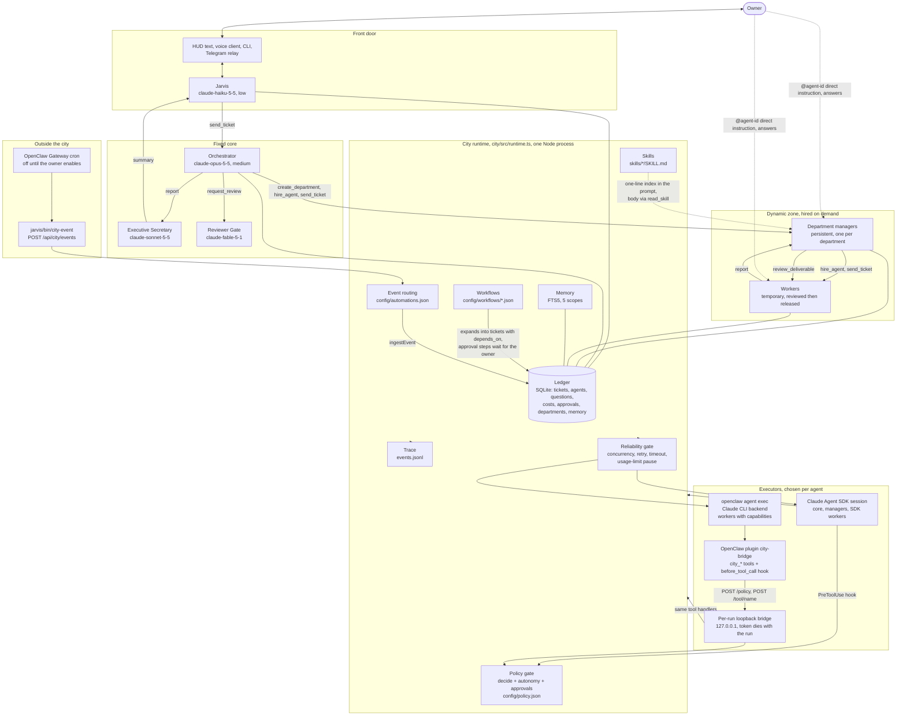

# AI City architecture

Written 2026-11-04 from the code on branch `feat/openclaw-nervous-system` (commit `b82cab3`). Every statement was checked against the source named next to it. Where a claim could not be checked it says so. Nothing here describes the result of a live run; live results are in `docs/ROADMAP.md` once the coordinating session fills them in.

`docs/ai-city.drawio` is the owner's blueprint and wins over this file where they differ. This file describes the code, not the drawing.

## Diagram

The two executors share one runtime. A worker whose spec has `executor: "openclaw"` runs through `createOpenClawRunner`; every other agent runs through `createRunner` (the Claude Agent SDK). Both are called from `callRunner` in `city/src/runtime.ts`, which wraps them in the reliability gate and the policy guard.

## What each part is

| Part | Where | What it does, as coded |
|---|---|---|
| Jarvis | `agents/core/jarvis.md`, `jarvis/server/city-chat.js` | The owner's conversation. Its own SDK session, shared by typed and spoken turns (conversation id `owner`). Hands work on with `send_ticket`. Its turns are recorded through `recordJarvisTurn`. |
| Orchestrator | `agents/core/orchestrator.md` | Plans, creates departments, hires managers, sends tickets, calls `request_review`, reports to the Secretary. The only agent with `reset_session`, `create_department`, `update_department`. Has no file or shell tools. |
| Secretary | `agents/core/secretary.md` | Gets a finished owner-side ticket and writes the plain-language summary. Its text becomes the `result` event Jarvis delivers. |
| Reviewer | `agents/core/reviewer.md` | Runs after the repo's own checks (`city/src/checks.ts`). Must answer PASS or FAIL as JSON; a reply with no verdict counts as FAIL. |
| Managers and workers | created by `hire` in `runtime.ts` from `agents/templates/*.md` | Hired from a spec validated against `schemas/agent_spec.schema.json`, stored in the ledger's `agents` table, reused when the id comes back. |
| Ledger | `city/src/ledger.ts`, file `~/.jarvis/ledger.db` | Tickets, agents, questions, costs, session baselines, compactions, departments, approvals. WAL mode, file mode 0600. Ticket ids are idempotency keys. |
| Policy gate | `city/src/policy.ts`, `config/policy.json`, `.claude/hooks/policy_gate.py` | `decide()` over regex rules, plus the runtime's `guardFor` for autonomy levels and approvals. |
| Reliability gate | `city/src/scheduler.ts` | One gate for every model call: at most `caps.max_concurrent_turns` (4) at once, `turn_timeout_minutes` (60) per turn, two retries with 5 s and 30 s backoff on transient errors, and a city-wide pause when the subscription's usage limit hits. |
| Memory | `city/src/memory.ts` | SQLite FTS5 (porter), ranked by BM25 plus a recency term. Scopes: agent, department, project, organization, jarvis. Refuses text that looks like a key. |
| Skills | `skills/`, `city/src/agents.ts` | 19 folders, each a `SKILL.md`. Departments and specs name skills; the prompt carries one line per skill. |
| Workflows | `config/workflows/`, `city/src/workflows.ts` | Four JSON workflows. `startWorkflow` turns steps into tickets with `depends_on`. An `approval` step is a ticket with `gate: true` that waits for the owner. |
| Event routing | `config/automations.json`, `ingestEvent` | An event `{source, type, summary, data}` is matched to a route and becomes one ticket to a department's manager, an agent, or the Orchestrator. Event data is quoted as untrusted. |
| Evals, report, merge gate | `city/src/evals.ts`, `measure.ts`, `improve.ts` | See "How the city improves itself". |
| Trace | `city/src/observability.ts`, file `~/.jarvis/events.jsonl` | One JSON line per city event (log lines excluded), mode 0600. `trace(ticketId)` reads back a ticket and everything split from it. |
| SDK executor | `city/src/sdk.ts` | One `query()` per turn, resumed by session id. Built-in tools limited to what the agent's prompt lists. City tools come from an in-process MCP server named `jarvis`. |
| OpenClaw executor | `city/src/openclaw.ts` | One `openclaw agent exec --json` process per turn with a pinned per-agent config. Needs no Gateway. |
| Bridge | `createBridge` in `openclaw.ts` | One HTTP server on `127.0.0.1`, random port, one random bearer token per run. Two routes: `/policy` and `/tool/<name>`. Body limit 1 MiB. The token is deleted when the run ends. |
| OpenClaw plugin | `city/openclaw-plugin/index.js` | Registers `city_report`, `city_ask_user`, `city_remember`, `city_recall`, `city_read_skill`, `city_ask_colleague`, and a `before_tool_call` hook at priority 1000 that asks the bridge for every tool call. If the bridge cannot be reached, the call is blocked. |

OpenClaw has a second, separate role in this repo: `jarvis/openclaw/` is a Telegram-to-Jarvis relay that does need the Gateway. It is a messaging channel, not an executor, and is described in `jarvis/openclaw/README.md`.

## Jarvis's direct line

Status checks do not go through the Orchestrator. Features and changes still do.

- `city_status` and `agent_status` read the ledger and make no model call.
- `ask_agent` forks the agent's session on Haiku with no tools and a 45 second limit, on no ticket of its own, so the agent's real turn is not disturbed. It answers from the ledger, and says so, when the agent has no session yet, was released, runs on OpenClaw, the city is paused, or no answer came in time.
- Only Jarvis has these tools. Each emits a `jarvis.visit` event, which the City view draws as Jarvis running over to that agent.

Live results on 2026-11-04, with a team working on a ticket: a status check took about 5 s, asking a manager about 6 s and asking a worker in the middle of its first turn about 8 s, with no Orchestrator turn. A turn announces its session as it starts, so a worker can be asked before its turn ends.

## Workers talking to each other

A worker can ask any other agent a question with `ask_colleague(name, question)`, across departments and without going through the Orchestrator. Work itself still moves by tickets through managers: a worker that needs another department to do something asks its own manager.

- It finds the agent by id, role or department (a department means its manager) and uses the same read-only fork and ledger fallback as `ask_agent`, so the colleague's real turn is not disturbed. The fork's cost goes to the agent that answers.
- It cannot reach core agents or itself. Managers do not have this tool.
- **Who is told:** both managers get a note, quoted as data, added to their next turn's input; no turn is spent on it. If the agent asked is a manager, it gets the note itself. Unread notes are lost on a restart.
- **The record:** `colleague.ask` and `colleague.answer` events appear in the City view's Activity feed and in `events.jsonl`, under the asker's ticket. The call is in the audit log. Text that looks like a secret is withheld from the notes and events, and each is cut to 200 characters.
- **The loop guard:** at most 6 questions between any two agents, in either direction, per 10 minutes. After that the call is refused and the asker is told to carry on or ask its manager. A fork has no tools, so a question can never set off another question. The count is in memory and resets on a restart.

Live result on 2026-11-04, on scratch data capped at Sonnet: a worker in Survey asked a worker in Archives for a codeword only the second one had been told. The answer came back in about 4 s, word for word, from a fork. The exchange showed in the Activity feed, the trace and the audit log, and the Archives manager had the note on its next turn. OpenClaw workers and the loop guard have unit tests only.

## The City view

`jarvis/hud/city.js` draws a small pixel world on a canvas from real state, using `city-state.js`. Nothing on it is decorative activity: every figure is a real agent, and a figure with nothing to do is at home.

- **Where an agent stands:** core agents at HQ. Others at a desk in their department while they have open work, are hired and not released, or wait for a merge. Otherwise at home.
- **What it shows:** `agent.activity` events drive the bubble (understanding, reading, coding, running, delegating, waiting for the team, in review). Clicking a figure opens its panel, which reads `GET /api/city/agent?id=` every 3 s while open.
- **Waiting for a merge:** a worker whose ticket finished with a branch in a workspace, its own ticket's or the sender's, keeps `awaiting_merge` after its release. Its session has ended, but it stays at its desk. `checkMerges` looks once a minute, and the worker goes home when the branch is merged, deleted or has no commits, or after 14 days. Merged means inside `origin/HEAD` or a merged GitHub PR, or inside `HEAD` for a repo with no remote, so checking a branch out to try it does not count. If the worker's ticket names no parent and its sender held several tickets, the city does not guess, and the worker goes home on release.

Agent-written text reaches the view as text only, after the same scrub as the rest of the snapshot. Live activity shows only a command's program and a URL's host and path, because the scrub cannot recognise every secret.

## How a ticket flows

1. **In.** The owner talks to Jarvis by text, voice or the relay. Jarvis answers quick personal tasks itself and otherwise calls `send_ticket`, which reaches `sendTicket` in `runtime.ts`.
2. **Validate and store.** The ticket is checked against `schemas/ticket.schema.json` and written to the ledger. A repeated id is a no-op. A ticket to a retired agent first revives it, which goes through the department cap; a refusal means no ticket is created. If `depends_on` names unfinished tickets it waits; if one of them already failed, this one fails at once.
3. **Dispatch.** `dispatch` sets the ticket `in_progress` and puts the target worker in `assigned`. Unless it is a direct instruction, or the target is the Secretary or Reviewer, the prompt gets up to four lines of relevant memory and the results of the tickets it waited for. Turns for one agent run one at a time (`deliver` keeps a queue per agent).
4. **Turn.** `turn` picks a session: managers and core agents keep one per root ticket, workers start fresh per ticket. A session past 60 % of its window is compacted first (the SDK's own `/compact`, else a Haiku summary, else a handover built from the ledger). The call goes through `callRunner`: reliability gate, policy guard, executor.
5. **Split.** The Orchestrator creates or reuses a department (`create_department` refuses a near-duplicate), then sends a ticket to its manager. The manager hires workers with `hire_agent`. Hiring is refused when the department is at its cap, when an idle worker with the same role exists, when the manager already has 4 workers, or when the department has already spent its daily budget. A manager can only hire into its own department and cannot hire a manager.
6. **Work.** A worker may ask for its own git worktree with `allocate_workspace`; the path becomes the ticket's scope and working directory. Questions go to the asker's parent first (`ask_user`); only what the parent answers `{"escalate": true}` to reaches the owner.
7. **Report.** `report` calls `finish`. The ticket becomes `done` or `failed`, the worker moves to `review` or `failed`, and the sender hears about it. For an OpenClaw worker the final message is the report.
8. **Accept.** A manager receiving a worker's `done` is told to call `review_deliverable`. Accept moves the worker to `completed`, writes the deliverable to department or project memory, and releases a temporary worker (session cleared, row kept). "Changes" sends a `fix` ticket back to the same worker. A manager that says nothing counts as having accepted.
9. **Review gate.** Before a PR or other gated step, `request_review` runs the repo's `npm test`, `lint` and `typecheck` (and pytest) in the ticket's scope, then the Reviewer. FAIL creates a `fix` ticket for the owning manager. After `max_review_rounds` (3) the owner is asked.
10. **Out.** When a ticket from the owner side finishes, the Secretary writes the summary and the runtime emits a `result` event. Jarvis tells the owner.
11. **Crash.** `resume()` re-asks open questions, re-dispatches unfinished tickets, re-opens approval steps, and parks anything idle for more than `resume_max_age_hours` (1) for the owner to resume or cancel.

Tickets that start outside a conversation (a schedule, a watcher) enter at step 2 through `ingestEvent`, with `from: "automation"`. Their results reach the owner the same way, through the Secretary and Jarvis.

## Where capabilities and approvals are enforced

The aim is that a prompt can be ignored or talked around and the tool layer still holds. These are the places where that is true in code.

**SDK agents** (`city/src/sdk.ts`, `runtime.ts`):
- `permissionMode: "dontAsk"`, `settingSources: []`, `strictMcpConfig: true`. Anything not on the allow list is denied rather than prompted.
- Built-in tools are limited to those the agent's prompt frontmatter lists (`builtinTools(allowedTools)`). A worker also gets `WORKER_TOOLS` (report, ask_user, remember, recall, read_skill, ask_colleague) whatever its spec says.
- City tools are filtered per agent (`toolsForTurn`): an agent whose prompt does not list `mcp__jarvis__hire_agent` is not given the tool at all.
- A `PreToolUse` hook calls `guardFor` for every tool call. It runs `decide()`; then, for tools outside the city's own and a short read-only list, the department's autonomy level (`read_only` denies, `supervised` asks); then the approvals table.
- Rules inside handlers: only the Orchestrator or owner side may create departments or hire managers; only a parent or the Orchestrator may retire an agent; `reset_session` is the Orchestrator's alone; `cancel_ticket` needs the sender, the manager or the owner side.

**OpenClaw workers** (`city/src/openclaw.ts`, `city/openclaw-plugin/index.js`):
- A pinned config is written per agent per run: minimal tool profile, only the groups its `capabilities` map to, a deny list (`gateway`, `cron`, `plugins`, `message`, `computer`, `group:agents`, and others), elevated tools off, bundled skills off, mDNS off.
- The measured behaviour that justifies the second layer (stated in a comment in `openclaw.ts`): on the Claude CLI backend the agent also sees native tools such as Write, Edit and Agent whatever the config says. All of them pass `before_tool_call`, so that hook is the real boundary. `capabilityAllows` lets a call through only if its tool is in the agent's capability table (or is a `city_*` tool); then the same `guardFor` as SDK agents applies.
- The hook fails closed: no bridge URL, no token, a non-loopback URL or a failed request all block the call.
- The plugin reports in when it loads. A run whose plugin never did is failed, because nothing in it was checked. A shell run could fake that report only if its hook were already broken, so this catches a load failure and is not a defence against an attacker.
- A run gets an allowlisted environment, so tokens in the server's environment do not reach it. SDK agents lose every secret-named variable except the Claude login, which `CLAUDE_CODE_SUBPROCESS_ENV_SCRUB` asks Claude Code to keep out of the shells it starts.
- No OS sandbox: see limits. Browser runs take turns because their ports are fixed.

**Approvals** (`guardFor`, `answer`, `askGate` in `runtime.ts`):
- An `ask` decision stores a pending approval keyed by a hash of agent, tool and sorted input, opens a blocking question and parks the ticket in `waiting_on_owner`. The tool call is refused for now.
- When the owner answers in the inbox, the answer is stored as granted or denied. The agent is told to repeat the exact call; it passes once and the approval is marked `used`.
- A relayed message cannot approve: a direct instruction from the owner side does not answer a question that has an approval attached. Only `answer()` does.
- Only a whole yes approves. Approvals cannot be decided on the phone listener. Cancelling a ticket denies its pending and unused approvals.
- No agent tool can report, review, cancel or ask on an approval step, an agent can report only tickets addressed to it, and only Jarvis can name another sender.
- A workflow approval step is a ticket with `gate: true` and an approval row `gate:<ticket>`. It survives a restart and is re-asked by `resume()`.

**What is not enforced at the tool layer** (stated so nobody assumes it is):
- The daily spend cap is checked only when hiring (`hire`). It does not stop turns by agents that are already hired. `Ticket.budget_usd` is in the schema and unused. A per-turn spend limit exists on the unmerged branch `fix/turn-spend-limit`.
- `idle_retire_minutes` is stored on the agent and never read.
- Fixed 2026-11-04 after the first version of this file: nine rules in `config/policy.json` (force-push, push to main, recursive delete of root or home, `terraform destroy`, `terraform apply` to prod, piping a download into a shell, the `git -c` and git-redirect rules, `gh repo delete`) matched the tool name `^Bash$` only, while an OpenClaw run's shell tool is named `exec`. `decide("exec", terraform destroy)` returned `allow`. Those rules now match `^(Bash|exec|bash)$`, and `exec` and `bash` cases are in both self-tests (`policy_gate.py --selftest`, 45 cases; `city/test/policy.test.ts`). Rules are still regular expressions over the JSON of the tool input, so a command written in a way the regex does not see is still not caught.
- Workers run directly on the owner's Mac under the policy gate, with no OS sandbox (see limits).

## How the city improves itself

Four parts, each usable without the next.

- **Evals** (`city/src/evals.ts`, `config/evals/*.json`, `jarvis eval`). Each task runs a real department in a throwaway city, in a temp folder with its own ledger, memory and audit log, so nothing reaches the owner's. A task passes only if its ticket ends `done` and every check holds: `file_matches`, `file_absent`, `result_matches`, or `command`. A question to the owner gets "no owner available" and an approval is denied. A usage limit stops the run and marks it, so it never counts as a score. A full run is appended to `~/.jarvis/evals.jsonl` with score, cost, time and a hash of each rules or scoring file, and compared with the last one. If any of those files differ the two scores are marked not comparable and the files are named. Workers run on the SDK executor only.
- **Report** (`city/src/measure.ts`, `jarvis report`, `GET /api/city/report`). Per department over a window: tickets, failures, gate retries (`retries` on the ticket), fix tickets, review rounds, cost, busy time, median ticket time, and problems seen at least twice once ids and numbers are removed.
- **Lessons** (`keepLesson` in `runtime.ts`). Every ticket that ends `done` or `failed` adds one line through `memory.remember`, kind `lesson`, with no model call: in its department's memory, or the agent's own for a core agent. A line the secret filter refuses is dropped and logged without its text. Lessons come back through the usual "data, not instructions" memory block.
- **Weekly loop** (`city/src/improve.ts`, `skills/self-improvement`). `city-event improve` sends the report as an `improve.weekly` event, which opens a ticket to the Orchestrator. It may end with one PR on an `improve/` branch, named in the ticket's artifacts. Off until the owner runs `jarvis/bin/city-automations enable weekly-improvement`.

**The merge gate.** `createImprover` runs in the server, watches for that ticket and checks the PR itself, one commit at a time, from cheapest to dearest. Nothing an agent says counts: it only names the PR.

1. The PR is open, not a draft, on an `improve/` branch of this repo (never a fork), aimed at `main`.
2. The changed paths from `git diff` against `main`. A change to `.github/` or `agents/core/reviewer.md` goes to the owner here. Any rules or scoring file is noted, to be named later.
3. GitHub Actions' `test` check run succeeded on that commit. It waits while CI runs, and gives up after 48 hours.
4. The Reviewer reads the diff from git, whole (over 200 KB goes to the owner). Only a reply that is wholly a PASS with no blocker or major finding counts.
5. `evalAtCommit` runs the evals in a separate process on a worktree of `main` and of the PR, both with `main`'s tasks. The PR must score at least `main`, and `main` must score above zero. A run stopped by a usage limit tries again later.
6. `gh pr merge --merge --match-head-commit <sha>`, so what merges is the commit that passed. A new commit starts over.

A merged change to the rules or scoring is named in the message to the owner, in `jarvis report`, and in the next weekly ticket. Any failed condition asks the owner a question and leaves the PR open. A PR seen once is never reconsidered. The state is the `improvements` table in the ledger, so it survives a restart. The merge lands on GitHub: the running service keeps its code until the checkout is pulled and it restarts.

**What may change, by the owner's decision (2026-11-04).** An earlier version refused to auto-merge changes to the city's protections. The owner removed that, so the loop may change `config/policy.json`, `.claude/hooks/`, `policy.ts`, `guardFor`, the approval code, `config/evals/` and the scoring code. Only `.github/` and the Reviewer's prompt are barred (`barred` in `improve.ts`), so a PR cannot rewrite the workflow or the instructions that judge it. `isRuleOrScoring` in `evals.ts` only decides what gets named.

What that means, plainly:
- A planted instruction that gets past the Reviewer can weaken the city's rules for good. The Reviewer, which reads untrusted text, is the only judge of what a change means.
- Some checks can still be changed by what they check. The bar covers the workflow file but not what it runs: a PR can change the `test` script in `package.json`, or edit or delete existing tests, and CI still passes. A PR's own `evals.ts` scores its own run, so it can fake its score; only the tasks stay `main`'s. A merged change to `improve.ts`, including removing this bar, applies to every later PR once the service runs it.
- Allowed changes to tests and prompts can also teach an agent the public eval answers.
- Naming a change tells the owner after the merge. It stops nothing.
- Workers skip the policy rules, so a steered worker can run `gh pr merge` itself, and GitHub requires only the `test` check on `main`.

To undo a merged change, revert its PR. `git log` and the `improvements` table record what merged.

## Limits, stated plainly

- **Workers run free, by the owner's decision (2026-11-04).** No OS sandbox, full tools by default, and `guardFor` applies neither the policy rules nor the city-controls check to a worker, so a worker can force-push, merge, read the Keychain, pay, destroy infrastructure, and change the ledger, audit log or policy file. Calls are still audited, though a worker could change that log too. Department autonomy levels still apply, and GitHub's protection of `main` is enforced outside the Mac, so pushes and merges to `main` still need a PR with CI passing. Agents read outside content, so a planted instruction can reach all of this.
- **No inbound webhooks.** They would need the Gateway to be publicly reachable, which the owner has forbidden. Events come from schedules and from a local `POST /api/city/events` on `127.0.0.1`.
- **Schedules are off.** `jarvis/bin/city-automations enable <id>` installs one in OpenClaw's scheduler, and it needs the Gateway. The Gateway is not running (nothing listens on port 18789 as of this writing). Nothing runs on a schedule today.
- **Anthropic models only.** No non-Anthropic provider is configured or used.
- **Lobster is not used.** It runs tool pipelines inside one agent. These workflows span departments, so they are tickets with dependencies in the ledger instead (`city/src/workflows.ts` says the same).
- **No third-party skills.** All 19 skills in `skills/` were written for this repo. `skills/README.md` sets the review rule for adding any.
- **Cost figures are estimates at API list prices, not charges.** The SDK reports a dollar figure per session and the runtime stores the per-turn difference. For OpenClaw runs, which do not price their turns, the figure is computed from token counts and the prices in `config/policy.json`. Those prices were not checked against Anthropic's published list for this document. `costReport()` labels its output `estimated: true`. Whether extra usage was ever billed on the subscription has not been verified.
- **`ANTHROPIC_API_KEY` is refused.** `assertNoApiKey` throws at start unless `JARVIS_ALLOW_API_KEY=1`. The OpenClaw runner also strips `ANTHROPIC_API_KEY` and `CLAUDE_CODE_OAUTH_TOKEN` from the environment it passes, because OpenClaw's Claude backend uses the `claude` login by itself. Everything runs on the Claude subscription.
- **Most outside MCP servers do not reach SDK agents.** `mcp_servers` in `config/policy.json` names each outside server and the agents allowed it, and `outsideServers` in `sdk.ts` enforces that. Today only Jarvis gets one, `personal-assistant`, limited to the tools its prompt lists. The servers in `.mcp.json` (github, terraform, meta-ads, playwright) are not available to a city agent, so Meta Ads and Terraform work cannot run through them yet. Jarvis can now read mail, which is untrusted text, in a session that also has `send_ticket`: the defence is its prompt and the tool-layer gates, not a filter.
- **One process owns the ledger.** The HUD server or the CLI, not both (comment in `jarvis/server/server.js`).
- **The Python voice pipeline has never run.** `jarvis/voice/` is unit-tested without audio; its README marks the audio path unverified.
